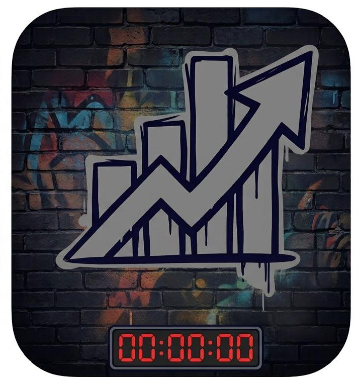

# DAYMARK — Personal Effectiveness & Daily Planner

A clean, minimalist, offline-first personal effectiveness tracker and daily planner built with React, Vite, and Supabase.



## Features

- **⏱️ Active Session Tracker**: Digital timer with real-time Start, Pause, Resume, and Reset controls.
- **⭐ Effectiveness Ratings**: 1–5 qualitative focus scale with reflection notes captured after each session.
- **📋 Daily Planner**: Checklist for planned tasks with straight strike-through completion, progress percentage bar, and one-click "▶ Track" shortcut to load tasks into the timer.
- **💾 Offline-First Architecture**: 100% functional offline using `localStorage` caching with zero dependencies on an active internet connection.
- **☁️ Supabase Cloud Sync**: Real-time authentication and PostgreSQL synchronization across devices when logged in.
- **🎨 Minimalist Design & Theme Switcher**: 3-way appearance toggle supporting System OS match, Dark mode, and Light mode.
- **🔔 Tactile Audio Cues**: Pure Web Audio API acoustic feedback for starts, pauses, and completions (with mute toggle).
- **📊 Offline Data Export**: One-click download of daily logs as CSV spreadsheets or JSON files.

## Tech Stack

- **Frontend**: [React 19](https://react.dev/), [Vite](https://vite.dev/)
- **Backend / Database**: [Supabase](https://supabase.com/) (PostgreSQL & Auth)
- **Styling**: Vanilla CSS (Tailored Design Tokens & Animations)
- **Linter**: [Oxlint](https://oxc.rs/)

## Getting Started

### 1. Clone & Install Dependencies

```bash
git clone https://github.com/bertsme/daymark.git
cd daymark
npm install
```

### 2. Configure Environment Variables

Create a `.env.local` file in the root directory:

```env
VITE_SUPABASE_URL=your-supabase-project-url
VITE_SUPABASE_ANON_KEY=your-supabase-anon-key
```

### 3. Run Development Server

```bash
npm run dev
```

### 4. Build for Production

```bash
npm run build
```

## License

MIT
